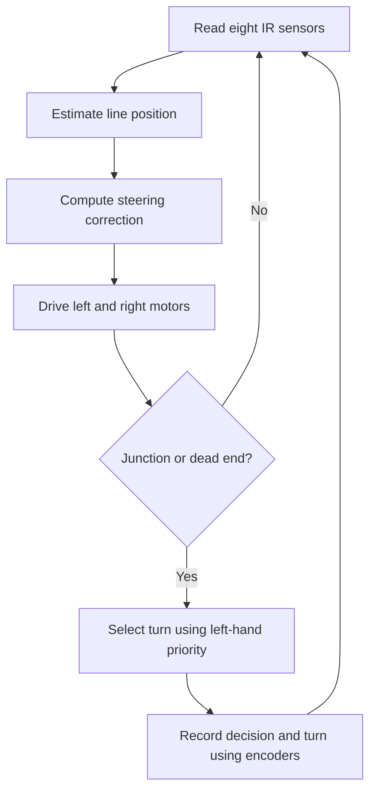

<div align="center">

# MESHMЕRIZE
### STM32 Autonomous Maze-Solving Robot

**8-channel IR sensing · PID steering · Encoder feedback · Maze exploration**

  

A compact, custom-built robot that follows lines, explores mazes and simplifies recorded turn sequences for a subsequent run.

[Hardware](#hardware) · [Architecture](docs/ARCHITECTURE.md) · [How it works](#how-it-works) · [Setup](#getting-started) · [Troubleshooting](docs/TROUBLESHOOTING.md)

</div>

---

## Overview

**Meshmerize** is a differential-drive maze-solving robot powered by an STM32F103C8T6 Blue Pill, RLS08 eight-channel IR reflectance array, TB6612FNG motor driver and two encoder-equipped N20 motors. The firmware combines line-position feedback, PID-style steering, left-hand-rule maze exploration and route simplification.

> **Prototype status:** The robot follows white vinyl tape on black chart paper more reliably than a fully printed vinyl maze. The printed-material tracking issue remains under investigation. This documentation refresh does not claim to fix it.

## Gallery

<div align="center">
 
</div>

<p align="center"></p>

[Demo video](images_videos/demo_video.mov) · [Wiring schematic](images_videos/Schematics%20Image.jpeg)

## Hardware

| Component | Specification |
| --- | --- |
| MCU | STM32F103C8T6 Blue Pill |
| Sensors | RLS08 eight-channel infrared reflectance array |
| Driver | TB6612FNG dual motor driver |
| Motors | 2 × N20 geared DC motors, ~300 RPM, with encoders |
| Power | 2 × rechargeable 3.7 V 600 mAh cells and buck converter |
| Chassis | Custom 2WD cut perfboard, two drive wheels and two casters |

### Pin mapping

The following is taken from `code/Config.h` rather than the older approximate schematic notes.

| Function | STM32 pins |
| --- | --- |
| Sensors 1–8 | PA1, PA2, PA3, PA4, PA5, PA6, PA7, PB0 |
| Right motor IN1 / IN2 / PWM | PB12 / PB13 / PB6 |
| Left motor IN1 / IN2 / PWM | PB14 / PB15 / PB7 |
| Left / right encoder A | PB10 / PB5 |
| Button | PA0 |
| Status / goal LEDs | PB2 / PB11 |

Verify actual supply voltages, ground connections and pin assignments before powering hardware.

## How it works



The initial traversal gives priority to left turns, then straight paths, then right turns, and reverses at dead ends. Recorded turns can be simplified for a later traversal. This is **not** a globally shortest-path guarantee for arbitrary mazes.

## Repository layout

```text
stm32-maze-solving-robot/
├── code/                 # Main firmware variant and Config.h
├── just_code/            # Alternate firmware variant
├── trial_code/           # Experimental firmware
├── images_videos/        # Photos, schematic and demo
├── docs/                 # Diagnostics and troubleshooting
├── CONTRIBUTING.md
└── README.md
```

These variants are not necessarily interchangeable. Confirm the corresponding configuration before flashing.

## Getting started

1. Install [Arduino IDE](https://www.arduino.cc/en/software) and a suitable [STM32 Arduino core](https://github.com/stm32duino/Arduino_Core_STM32).
2. Clone this repository:

   ```bash
   git clone https://github.com/XDecoder12/stm32-maze-solving-robot.git
   cd stm32-maze-solving-robot
   ```

3. Open `code/code.ino` with its companion `code/Config.h` in the same sketch folder. On case-sensitive systems, match the header filename casing to `#include "config.h"`.
4. Choose the STM32F103C8T6 board and an upload method supported by your hardware.
5. Check wiring and voltage levels; test motor directions with wheels lifted before running on the track.

Exact board settings depend on the installed STM32 core version; a reproducible pinned build is not yet provided.

## Calibration and tuning

The main sketch appears to initialize `sensor_min` to 0 and `sensor_max` to 4095, which can prevent calibration extrema updates for a normal 12-bit ADC. This is a **suspected firmware defect, not a verified fix**. Compare raw black/white sensor values before retuning PID for new materials.

Read the [troubleshooting guide](docs/TROUBLESHOOTING.md) for a structured test procedure.

## Contributing

Bug reports, reproducible sensor logs, documentation improvements and firmware changes are welcome. See [CONTRIBUTING.md](CONTRIBUTING.md). State whether proposed firmware changes were physically tested.
