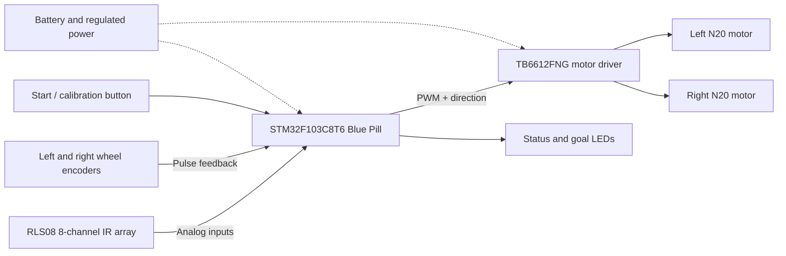
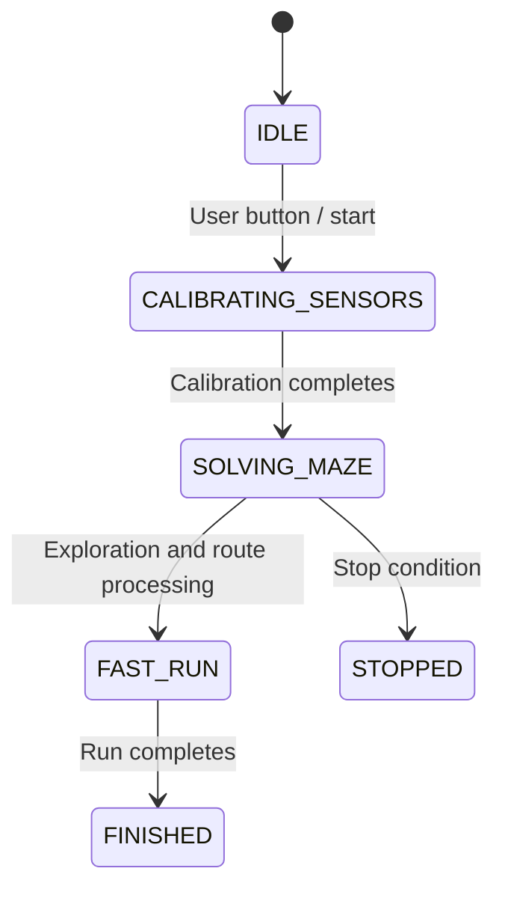

# Meshmerize — System Architecture

This guide describes the current main firmware variant in [`code/`](../code/). It documents the implemented design; it does not claim that all behaviors have been independently hardware-validated.

## System overview

The controller reads the line sensors, makes navigation decisions and controls motor outputs. Encoder pulses provide motion feedback for fixed-distance travel and turning. Check the physical power wiring before using the diagram as a wiring reference.

## Hardware interface

| Interface | Pin(s) | Purpose |
| --- | --- | --- |
| Sensor 1–8 | PA1–PA7, PB0 | Read the eight reflectance channels |
| Right motor | PB12, PB13, PB6 | Direction and PWM |
| Left motor | PB14, PB15, PB7 | Direction and PWM |
| Left / right encoder A | PB10 / PB5 | Motion tick inputs |
| Button | PA0 | User input |
| Status / goal LEDs | PB2 / PB11 | State indication |

The source of truth for pin mappings is [`code/Config.h`](../code/Config.h). In the firmware, the internal sensor pin array is listed in reverse sensor-number order; inspect the implementation before making assumptions about physical left/right ordering.

## Firmware structure

The main program is [`code/code.ino`](../code/code.ino), with constants and wiring assignments in [`code/Config.h`](../code/Config.h).

### Operating states

The diagram summarizes the intended operational sequence; precise transition handling and button behavior are defined in the source code.

### Main control pipeline

1. **Sensing:** `readSensorsAnalog()` samples the reflectance channels, and `readSensorsDigital()` classifies them relative to configured thresholds.
2. **Line-position estimation:** `calculateError()` uses active sensor measurements to estimate lateral line error.
3. **Steering:** `pidControl()` applies the active proportional and derivative gains (and an integral term configured to zero by default) to derive left/right motor commands.
4. **Motor actuation:** `motorControl()` applies PWM and direction outputs to the driver.
5. **Junction handling:** `followSegment()` advances until it detects a candidate junction or line-loss condition; `solveMaze()` evaluates paths using left-hand priority.
6. **Motion feedback:** `forwardEncoderPID()` and the turning routines use encoder ticks for motion positioning.
7. **Route processing:** `simplifyPath()` reduces the stored turn sequence, which `runFast()` uses during a subsequent traversal.

## Configuration and tuning

The two operating modes use different gains and speeds, declared in `Config.h`:

| Parameter | Current configured value |
| --- | ---: |
| `KP_TRIAL` / `KD_TRIAL` | 40.0 / 165.89 |
| `KP_FAST` / `KD_FAST` | 80.0 / 410.0 |
| `KI` | 0.0 |
| `BASE_SPEED` / `FAST_SPEED` | 130 / 230 |
| `TURN_SPEED` / `FAST_TURN_SPEED` | 80 / 70 |
| `TICKS_FOR_90_DEG_TURN` | 255 |
| `TICKS_FOR_180_DEG_TURN` | 510 |
| `TICKS_SENSORS_TO_AXLE` / `FAST_TICKS_SENSORS_TO_AXLE` | 250 / 130 |

These are values from the current source, not universal recommendations. Do not change tuning until surface sensing and motor orientation have been validated.

## Known limitations and investigations

- **Surface-dependent sensor performance:** The prototype performs differently on white vinyl tape over black chart paper versus a fully printed vinyl track. See [Troubleshooting](TROUBLESHOOTING.md).
- **Calibration extrema:** The main sketch initializes `sensor_min` to 0 and `sensor_max` to 4095; that may prevent adaptive extrema updates when using a 12-bit ADC. This is a code-level concern awaiting measurement and firmware validation.
- **Junction and line loss:** `followSegment()` stops the segment when five or more sensors are active or when none is active. Noisy sensor classification can therefore affect navigation decisions.
- **Route optimality:** The exploration strategy and simplification do not guarantee a globally shortest route through every possible maze.
- **Build reproducibility:** No pinned build environment or automated hardware validation is currently included.

## Firmware variants

| Directory | Role |
| --- | --- |
| [`code/`](../code/) | Main firmware and active configuration used as the basis for this guide |
| [`just_code/`](../just_code/) | Alternative sketch and associated configuration |
| [`trial_code/`](../trial_code/) | Experimental sketch and associated configuration |

Do not assume these sketches are behaviorally identical or interchangeable. Validate each variant on the actual hardware before describing it as stable.
